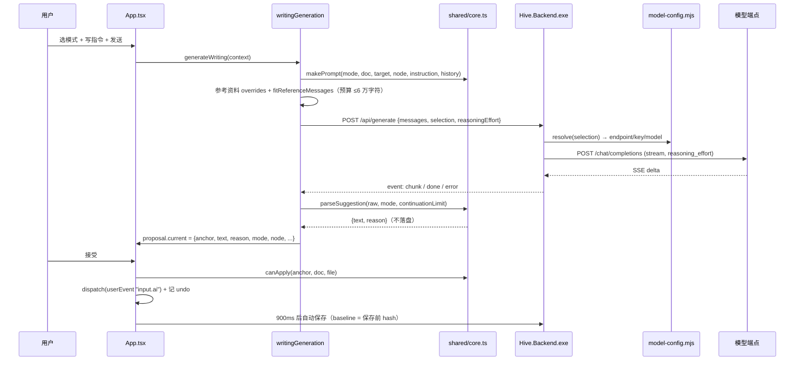

# HIVE 0.1.9 架构

生产桌面由 Electron 主进程启动自包含 `Hive.Backend.exe`。C# 后端负责本地 HTTP、仓库及持久化、模型与流式生成、工具、主题与插件、外部文稿、偏好和更新。Electron 保留原生窗口、对话框、preload IPC 和系统外壳调用。React 编辑器继续持有编辑状态、撤销历史、未保存内容及窗口归属。

本地 HTTP 和数据格式见 [后端契约](backend-contract.md)。包内文件、开发入口和退出协议见 [桌面封装](packaging.md)。

> 本文描述当前分层、数据流与状态归属。文档保存与同步的协议见 [后端契约](backend-contract.md)。

## 1. 分层总览

```mermaid
flowchart TB
  subgraph B["浏览器 · 单页应用（Vite 构建）"]
    UI["app/App.tsx · 工作台装配与文档会话"]
    ACTIVE["editor/activeEditor · 活动会话只读引用"]
    GEN["chat/writingGeneration · 生成编排（351 行）"]
    TRANS["chat/generationTransport · SSE / 演示传输（142 行）"]
    PROP["chat/proposalActions · 接受/驳回/撤销（105 行）"]
    PERS["files/useDocumentPersistence · 保存快照、回执与同步"]
    REFS["chat/referenceSources · 参考资料与字符预算（78 行）"]
    WS["workspace · 停靠树/浮动/自动隐藏/手势/视图预设（29 文件）"]
    DP["workspace/DesktopPanels · 面板移出/移回独立窗（123 行）"]
    ED["editor · CodeMirror 扩展 + 格式化/插入/显示模式/表格（49 文件）"]
    FEAT["files / chat / outline / scratch / annotations / settings / ribbon / theme / typography"]
    CTX["files/WorkspaceContext · request() 统一出口"]
    UI --> GEN
    UI --> ACTIVE
    UI --> PERS
    UI --> WS
    UI --> DP
    UI --> ED
    UI --> FEAT
    GEN --> TRANS
    GEN --> PROP
    GEN --> REFS
    FEAT --> CTX
    PERS --> CTX
    GEN --> CTX
    WS --> CTX
  end

  subgraph S["Hive.Backend.exe · C# / ASP.NET Core"]
    GUARD["Host/Origin 校验 · Cache-Control: no-store"]
    QUEUE["每写作空间 POST 串行队列"]
    DOCROUTES["Program.cs · 正文 / 草稿 / 目录 / 同步"]
    SPACE["Workspaces.cs · 空间上下文 / 仓库管理"]
    FILES["Files.cs · Markdown 读写 / 改名 / 事务"]
    FIDX["Files.cs · 目录快照 / treeVersion / 监听 / 60 秒兜底"]
    FPROBE["Files.cs · 外部修改检查（≤100 项 / 30 秒）"]
    EXPL["Explorer.cs · 新建 / 改名 / 移动 / 复制 / 回收站 / 搜索"]
    IMG["Media.cs · 图片落盘与预览"]
    IMP["Media.cs · 图片与 Markdown 导入"]
    REF2["References.cs · 参考资料解析（≤32 项 / 6 万字符）"]
    META["Metadata.cs · 结构改动后重映射标注和大纲"]
    ANN["Metadata.cs · 标注"]
    NODES["Metadata.cs · 写作大纲"]
    OUTL["Metadata.cs · 大纲描述"]
    TPL["CatalogService.cs · 模板、图标、配色与插件"]
    MODEL["Models.cs · 服务与模型配置"]
    MCAP["Models.cs · 上游能力映射"]
    MPROBE["Generation.cs · 模型目录探测与测试生成"]
    GENOPT["Generation.cs · 推理档位与请求预算"]
    TRASH["Explorer.cs · 回收站预览与清理"]
    TIMES["FileSystemIdentity.cs · 创建时间身份校验"]
    DESK["ShellBridge.cs · 私有进程管道"]
    GENR["/api/generate · SSE 代理"]
    GUARD --> QUEUE --> SPACE
    QUEUE --> DOCROUTES
    DOCROUTES --> FILES
    DOCROUTES --> FPROBE
    SPACE --> FILES
    FILES --> FIDX
    SPACE --> EXPL
    SPACE --> IMG
    SPACE --> IMP
    SPACE --> REF2
    SPACE --> ANN
    SPACE --> NODES
    SPACE --> OUTL
    SPACE --> TPL
    EXPL --> META
    EXPL --> TRASH
    FILES --> TIMES
    GUARD --> MODEL
    MODEL --> MCAP
    GUARD --> MPROBE
    GENR --> GENOPT
    GENR --> MPROBE
    GUARD --> GENR
    GUARD --> DESK
  end

  subgraph D["Electron 外壳（desktop/main.mjs，363 行；desktop 共 19 个非测试文件）"]
    MAIN["主进程 · 起服务子进程 / 无边框主窗 / 关闭与退出协议 / 放行面板窗"]
    PRE["preload.cjs · window.hiveDesktop（关闭、窗口命令、面板回搬、偏好）"]
    PREF["preload → NativeData.cs · 界面偏好"]
    WPOL["windowPolicy.cjs · 精确入口首次导航放行 + 窗口命令白名单 + 子窗禁最大化"]
    GEOM["panelGeometry.cjs · 子窗坐标换算与夹取"]
    PREADY["panelReady.cjs · 子窗就绪登记"]
    REPICK["repositoryPicker.cjs · 仓库目录选择对话框"]
    TSRC["DesktopPaths.cs · 源模板目录定位"]
    TIP["tooltipManager / tooltip-overlay · 桌面提示浮层"]
    DOCK["dock-overlay.cjs · 面板拖拽停靠预览"]
    FREV["fileReveal.cjs · 在资源管理器定位文件"]
    ABOUT["about.cjs + buildMetadata.cjs · 关于页数据与构建编号"]
    PANEL["独立面板窗 · /?panelWindow=&lt;id&gt;（同源 window.open，frame:false）"]
    MAIN --> PRE
    MAIN --> PREF
    MAIN --> WPOL
    MAIN --> GEOM
    MAIN --> PREADY
    MAIN --> REPICK
    MAIN --> TSRC
    MAIN --> TIP
    MAIN --> DOCK
    MAIN --> FREV
    MAIN --> ABOUT
    MAIN --> PANEL
  end

  MAIN -->|"spawn Hive.Backend.exe（HIVE_PORT=0）"| GUARD
  MAIN -->|"hive-ready / hive-shutdown"| SPACE
  PRE -->|"hive:close-* / hive:panel-close / hive:panel-ready / hive:window-command"| MAIN
  DP -.->|"portal 容器 DOM 搬移（同源 document）"| PANEL
  CTX -->|"fetch /api/* + X-Hive-Workspace"| GUARD
  GENR -->|"OpenAI 兼容 /chat/completions"| LLM["外部模型端点"]
  FILES --> DOCS["documents/**/*.md"]
  IMG --> PICS["documents/<文档名>pic/ 图片"]
  EXPL --> TRASHF["documents/.hive-trash/ 回收站"]
  SPACE --> LOCAL[".local/ 状态 JSON"]
  MODEL --> LOCAL
  ANN --> LOCAL
  NODES --> LOCAL
  OUTL --> LOCAL
```

## 2. 分层职责

| 层 | 位置 | 职责 | 不该做的事 |
| --- | --- | --- | --- |
| 入口 | `index.html` → `src/main.tsx` | 挂载 `<App />`；URL 带 `panelWindow` 时**不挂载**（独立面板窗只是空 document，等父窗搬 DOM 进来） | 不含任何业务逻辑 |
| 桌面外壳 | `desktop/main.mjs` + `desktop/*.cjs`（preload、preferences、windowPolicy、panelGeometry、panelReady、repositoryPicker、templateSource、tooltipManager/tooltip-overlay、dock-overlay、fileReveal、about、buildMetadata） | 起服务子进程、开无边框窗口、放行独立面板窗、窗口命令、关闭/退出协议、界面偏好落盘 | 不写业务、不碰文档；不替渲染端决定保存 |
| 工作台 | `src/app/App.tsx`、`features/editor/activeEditor.ts` | 编辑会话表、活动会话读取、面板装配、快捷键、对话框、标注粘合、视图快照 | 不写生成协议（在 `chat/writingGeneration`）、不写保存循环（在 `useDocumentPersistence`）、不写几何算法（在 `workspace`） |
| 生成编排 | `features/chat/writingGeneration.ts` | 组装上下文 → 调 `makePrompt` → 选传输 → 解析建议 → 写 `proposal` | 不碰 DOM 布局，不直接改正文（只产建议） |
| 传输 | `features/chat/generationTransport.ts` | 演示模式本地造文本；真实模式读 SSE、抛可读错误 | 不解释产品语义 |
| 建议动作 | `features/chat/proposalActions.ts` | `accept` / `reject` / `undoAI`，全部经 `canApply` | 不组装提示词 |
| 持久化 | `features/files/useDocumentPersistence.ts`、`writeDocument.ts` | 900ms 自动保存、请求结束后 2s 磁盘同步、文件冲突处理，按快照与仓库归属应用保存回执 | 不决定编辑器内容 |
| 面板层 | `features/workspace/*` | 停靠树、浮动矩形、标签页、拖拽停靠、自动隐藏、图标轨道手势、面板锁手势、视图预设、面板目录/搜索；`DesktopPanels` 负责把面板搬进系统独立窗口 | 不认识「文档/标注」等业务语义（面板 id 由 App 决定） |
| 编辑器能力层 | `features/editor/*.ts` | 纯函数：格式化、插入、显示模式、预览计划、查找替换、打字机、状态栏统计、表格控件、笔记属性、frontmatter | 不直接发请求、不持有磁盘状态 |
| 编辑器视图层 | `features/editor/Editor.tsx` | CodeMirror 实例、扩展装配（`makeState`）、上下文菜单与插入对话框的挂载点 | 不决定保存策略 |
| 功能层 | `features/{files,chat,outline,scratch,annotations,settings,ribbon,theme,typography}` | 每个面板的交互与本地状态 | 不直接拼 URL（统一走 `useFileWorkspace().request`） |
| 传输层 | `features/files/WorkspaceContext.tsx` | `request(path, init)` 前缀 `/api` 并注入 `X-Hive-Workspace`，`register()` 登记切换前拦截 | 不解释业务错误 |
| 服务层 | `backend/Program.cs`、`ShellBridge.cs` | HTTP 装配、工作区请求队列、流式路由接入、错误映射与私有进程通信 | 业务落盘由对应 C# 模块处理 |
| 存储层 | `server/{files,workspace,explorer,images,imports,references,annotations,writing-nodes,outlines,model-config,model-capabilities,model-probe,templates,file-index,file-probe,generation-options,metadata-paths,trash-retention,file-times}.mjs` | 原子写、锁、revision/hash 冲突检测、路径重映射、保留期清理 | 不做 HTTP 语义 |

## 3. 面板清单

| 面板 id | 组件 | 说明 |
| --- | --- | --- |
| `files` | `features/files/FileExplorer.tsx` | 文档树：新建/改名/移动/复制/回收站/还原/在资源管理器显示/排序/过滤 |
| `conversation` | `features/chat/WritingDock.tsx` | 对话与生成：模式、指令、消息流、模型选择、推理强度 |
| `outline` | `features/outline/WritingOutlineV2.tsx` | 写作节点大纲（可绑标题、带描述） |
| `toc` | `features/outline/TableOfContentsPanel.tsx` | 只读标题目录，折叠与定位 |
| `scratch` | `features/scratch/ScratchPad.tsx` | 自由草稿（固定文件 `自由草稿.md`） |
| `annotations` | `features/annotations/AnnotationPanel.tsx` | 文本标注列表与批量送 AI |
| `basis` | `features/chat/InputBasisPanel.tsx` | 本轮会发给模型的内容摘要（可见即所发） |
| `search` | `features/editor/FindReplacePanel.tsx` | 查找替换（正则/整词/大小写） |
| `trash` | `features/files/TrashPanel.tsx` | 回收站：按保留期预览、两步清理、行内永久删除、还原 |
| `repositories` | `features/files/RepositoryPanel.tsx` | 仓库管理：添加/备注/移除/重排写作空间仓库 |
| `editor`、`editor:<uuid>` | `features/editor/Editor.tsx` | 正文编辑区，可多开；`editor` 是主编辑区，永不被彻底移除 |

已知面板 id 的权威清单在 `features/workspace/viewPresets.ts:40`（保存视图时校验），新增面板必须同步。

## 4. 一次「按大纲节点完成」的生成时序

要点：**模型永远只产出建议文本**；写进正文必须经过 `canApply` 校验，失败即标 `stale` 并要求重新生成。

## 5. 状态存在哪里

| 内容 | 位置 | 说明 |
| --- | --- | --- |
| 用户 Markdown | `documents/**/*.md`（`HIVE_DOCUMENTS` 可改） | 只允许 `.md`，禁符号链接，单文件 ≤ 2 MB |
| 图片 | `documents/<文档名>pic/*` | 上传 ≤ 12 MB；文件名去非法字符后去重；预览只允许空间内相对路径 |
| 回收站 | `documents/.hive-trash/<uuid>` + 同名 `.json` | 删除即移入；还原按记录回原路径，冲突即拒绝 |
| 写作空间设置 | `.local/workspace.json` | `{root,autoSave,revision,repositories:[{id,root}]}`；非默认空间在 `.local/workspaces/<id>/` |
| 草稿 | 当前空间根下的 `自由草稿.md` | 旧版 `.local/scratch.md` 仅在目标缺失时迁移 |
| 标注 | `.local/text-annotations.json` | 键 `source:file`，含 `revision` + 文本 `fingerprint` |
| 写作节点 | `.local/writing-outline-nodes.json` | 按文件存 `revision/initialized/nodes` |
| 大纲备注 | `.local/writing-outlines.json` | 按文件存 `{headingKey: description}`（旧版遗留，无 revision） |
| 文件创建时间 | `.local/file-times.json` | 以 `dev/ino/birthtimeMs` 作为身份，原子替换后不冒充旧创建时间 |
| 模型配置 | `.local/model.json` | `schemaVersion: 2`；服务密钥明文存 `state/keys.json`（`0o600` 原子写、跨重启有效，`read()` 只回 `hasKey`）；`HIVE_API_KEY` 仅在尚无 keys.json 时注入 |
| 界面外观 | `localStorage: hive.appearance.v1` | `uiScale/textScale/editorSize/ribbonVisible/ribbonCollapsed` |
| 主题 / 排版 / frontmatter | `localStorage: hive.theme.v1 / hive.typography.v1 / hive.frontmatter-visible.v1` | 桌面版经偏好白名单同步回写 `ui-preferences.json` |
| 底栏项 | `localStorage: hive.editor-status.v2` | 旧 `v1` 自动迁移；项集合与计数口径见 `statusModel.ts` |
| 视图预设 | `localStorage: hive.views.v1:<workspaceId>` | 按写作空间隔离 |
| 文件排序 | `localStorage`（`explorerState.readOrder`） | 手动顺序 + 按名/按修改时间 |
| 参考资料 | `localStorage`（`referenceSources.readReferenceSources`） | 每个「空间 + 文档」各存一份来源列表 |
| 推理强度 | `localStorage`（`modelReasoning`，按服务/模型分键） | `default` + 七档 `off/minimal/low/medium/high/xhigh/max`（有效档随所选模型声明） |
| 界面偏好（桌面版） | `<userData>/ui-preferences.json` | 浏览器版只有 localStorage；桌面版由 preload 在启动时灌入、每 2s 回写白名单 key（上限 256 条 / 单值 131072 B / 总量 524288 B） |

## 6. 内存与性能约束（2026-11-16 首批，2026-11-19 复核增补）

| 位置 | 约束 | 破了会怎样 |
| --- | --- | --- |
| `editor/tableWidget.ts` `cellContent` | 取单元格文本用 `doc.sliceString(from,to)`，`doc` 传 `EditorState.doc`（`Text`），不传 `doc.toString()` | 每个单元格展开一遍全文，大文档内存峰值翻倍 |
| `annotations/annotationCache.ts` `pruneAnnotationCache` | 只淘汰 `!==active && !busy && !loading && !error && seq===savedSeq` 的记录，上限 12 条 / 4 MiB | 放宽过滤会丢用户标注；完全不裁剪则切文档越切越涨 |
| `server/document-routes.mjs` `/api/workspace/sync` | 请求可带 `baselines` 与 `treeVersion`；hash 相同回 `unchanged` 不带正文；目录快照版本未变时省略 `entries`；最多 4 并发读 | 每次轮询重复返回全文和目录 |
| `server/file-index.mjs` | 每仓库 ≤1 个在途扫描、每批 ≤16 任务；缓存 ≤25000 条 / 路径字符 ≤4M；监听只标记失效，60s 兜底才重扫 | 目录扫描堆积或缓存无界，大仓库越用越慢 |
| `server/file-probe.mjs` | 在途外部修改检查 ≤100 份、30s 重验、文档关闭即移除 | 每次轮询全量 stat，句柄与内存随文档数增长 |
| `server/file-times.mjs` | 磁盘状态文件 ≤16MiB；整体签名不变直接复用 | 大仓库每次保存都全量解析 JSON |
| `chat/generationTransport.ts` | `abort` → `reader.cancel()`，`finally` → `reader.releaseLock()` | 连接与 body 锁不释放，连续生成会挂住句柄 |
| `app/App.tsx` 关闭/收纳 | 先存 `view.state` + `scrollDOM.scrollTop`，再卸载视图 | 撤销历史与滚动位置丢失（内容还在，因为 `session.state` 是独立保存的） |

## 7. 全局不变量（改代码时不要破）

1. **磁盘优先**：正文以磁盘为准；内存中未保存的修改通过 `baseline`（hash）保护，冲突时阻止覆盖而不是自动合并。
2. **建议不落盘**：`proposal` 只是内存态，接受后才 dispatch，且必须走 `canApply`。
3. **位置即语义**：标注与建议都用 `{from,to,original}` 锚定；正文变化后用 `mapAnchor` / `mapAnnotations` 迁移，重叠即失效。
4. **单窗口写者**：同一空间多窗口并发由 `revision` / `x-hive-workspace` 拦下，返回 409 而不是后写覆盖；POST 在服务端按空间串行。
5. **结构改动连元数据一起搬**：改名/移动/回收站必须在同一事务里 `remapMetadata`，否则标注与大纲会指向旧路径。
6. **本机限定**：`/api/*` 只接受 `127.0.0.1` / `localhost` 的 Host，跨源请求拒绝。
7. **只代理不代持**：服务端不存对话历史、不把密钥写盘；每次生成由前端携带完整 `messages`。
8. **图片只读空间内**：预览只接受相对路径，拒绝 `http(s):`、绝对路径与符号链接，响应带 `nosniff` 与 sandbox CSP。
9. **参考资料只读且计预算**：最多 32 项来源、合计 ≤ 6 万字符；超预算只截断并回传 `warnings`，不改原文件。
10. **清理要两步**：回收站按保留期 `preview` 出清单与 token，`purge` 必须带同一 token，未确认的记录不动。
11. **不用的视图要卸掉，状态要留下**：面板关闭/收纳时 `EditorView` 随 `<Editor>` 卸载，但 `EditorState`、撤销历史与滚动位置留在 session（`restoreScroll`）；内存优化只许释放「能重建的」东西（非活动且干净的标注缓存、已收尾的流），未保存内容、出错记录、在途请求一律保留。
12. **一个面板只被一个 document 持有**：独立窗口的面板由 `createPortal` 的稳定容器（`.desktop-panel-surface`）承载，换窗口只是 `appendChild` 到另一个 document；搬完必须对容器内每个 `.cm-editor` 执行 `EditorView.findFromDOM(el).setRoot(doc)` + `requestMeasure()`，否则键盘、选区、测量仍指向旧 window。面板组件本身**不重挂**——状态、撤销历史、未保存稿都在原 React 树里。
13. **关子窗先回搬再销毁**：子窗 `close` 被主进程拦下 → `hive:panel-close-requested` → 渲染端 `attach()` 搬回主窗 → 才发 `hive:panel-close` 让主进程 `destroy()`。顺序反了 React 找不到容器节点，面板直接消失。退出同理：先给所有 document `body.inert=true` 挡输入，再保存，最后 `finishClose(true)`。

## 8. 桌面外壳与独立窗口（2026-11-16 现状）

外壳细节见 [packaging.md](packaging.md)，这里只记「跨窗口之后架构上多了什么」。

| 问题 | 现状做法 | 破了会怎样 |
| --- | --- | --- |
| 子窗里的 React 事件 | 只搬 `createPortal` 出来的容器节点（React 19 把监听挂在 portal 容器上），面板组件不重挂 | 直接搬 `<aside>`（在 `#root` 内）→ 合成事件全失效 |
| 子窗里的 document | `shared/panelDocument.tsx` 的 `PanelDocumentContext` + `usePanelDocument()`，12 处消费（`Editor`、`EditorContextMenu`、`DisplayModeControl`、`PanelControl`、`ModelPicker`、`WritingModeControl`、`InputBasisPanel`、`FileExplorer`、`WritingOutlineV2`、`AnnotationPanel`、`useAnnotationTool`、`ScratchPad`） | 菜单/浮层 `createPortal(…, document.body)` 弹回主窗 |
| 全局快捷键 | `App.tsx:637-638` 每次渲染把 `keydown` 同时绑到 `window` 和每个子窗；`App.tsx:213` 的 Esc 取消（关标注浮层）也遍历 `[document, ...子窗 document]`；处理函数里用 `event.target.ownerDocument` 判断当前 document | 子窗里 Ctrl+S / Ctrl+F / Esc 全失灵 |
| 样式 | `mirrorAppearance()` 克隆父窗 head 的 `style`/`link[rel=stylesheet]`（带 `data-hive-mirror`，CSSOM 规则用 `sheet.cssRules` 展开），并用 `MutationObserver` 跟随父窗 head 与 `documentElement` 的 class/style/lang | 子窗白屏（Vite 的 CSS 只注入父 document） |
| 坐标系 | 子窗内 CSS 强制 `.desktop-panel-surface > .workspace-panel{position:fixed;inset:0}`，隐藏 `panel-resize`；面板不进停靠树 | 沿用父窗舞台坐标 → 面板跑到屏幕外 |
| 移出后的主窗 | 无占位卡片、无定位/移回按钮；主窗只留 `display:contents` 的 `.desktop-panel-home` 占位节点，移回的唯一入口是子窗标题栏的面板菜单（`PanelControls` 的 `floatAction` 在 detached 时显示「移回主窗口」→ `desktop.attach(id)`） | 面板在子窗里编辑、主窗看不见它；没有占位与入口时用户会以为面板丢了 |
| IME | 组词中拒绝移出/移回/退出（`compositionstart/end` 捕获 + `EditorView.composing`），文案「请先完成当前输入法组词」 | 组词被打断，输入法状态与编辑器错位 |
| 崩溃/刷新 | 500ms 轮询 `child.closed`、15s 连接超时、子窗 `unload` → `restore()` 自动回搬；主进程侧 `before-input-event` 拦 F5 | 子窗白屏或面板丢失 |
| 窗口与边框 | 主窗与子窗都 `frame:false`；拖拽区靠 `.hive-desktop .app-header` 与子窗面板标题栏的 `-webkit-app-region:drag`（按钮/输入框设 `no-drag`）；主窗右上角 `.header-window-controls` 三键（最小化/最大化还原/保存并退出），子窗标题栏菜单只有最小化与「关闭窗口并移回主窗口」，全部走 `windowCommand(command, panelId?)` → `hive:window-command` | 无边框窗口没有可拖区域，或按钮把窗口拖走 |
| 子窗不可最大化 | 主进程 `maximizable:false` + `windowPolicy.commandAllowed(command, isPanel)` 拒绝 `maximize` + 监听 `maximize` 事件强制 `unmaximize()` 并还原 `normalBounds` | 子窗铺满整屏后没有回搬入口，用户以为面板丢了 |
| 窗口唤醒 | `second-instance` / `activate` / 主窗 `focus` 都走 `showAllWindows()`：恢复主窗 + 所有已 `panelReady` 的子窗（`showInactive`/`moveTop`），焦点给 `lastActivePanel`，`restoringWindows` 防重入，未就绪子窗不显示 | 点任务栏只回来主窗，子窗留在后面或最小化态；未就绪子窗冒出空白窗 |
| 全局弹窗归属 | 设置、使用指南、文件选择、通用 `dialog`/`confirm` 仍在主窗渲染；`App.tsx:677` 一旦它们打开就 `window.focus()` 把主窗拉到前面 | 在子窗里操作却看不到弹窗，以为按钮坏了 |
| 子窗何时显示 | 子窗创建时 `show:false`；渲染端把容器搬进去、确认有 `[data-panel-id]` 后调 `panelReady(id)` → 主进程 `show()` | 先显示后搬 DOM → 白屏闪一下；搬失败就留下空窗 |
| 关闭一个已移出的面板 | `closeEditor` / `minimizeEditor` 先 `desktopPanels.attach(id)`（失败即中止），再走原来的卸载逻辑；子窗标题栏「关闭窗口并移回主窗口」= `windowCommand('close', id)` → 主进程拦下 → 回搬 | 子窗还拿着 DOM，父窗卸载 → 面板消失、子窗空白 |
